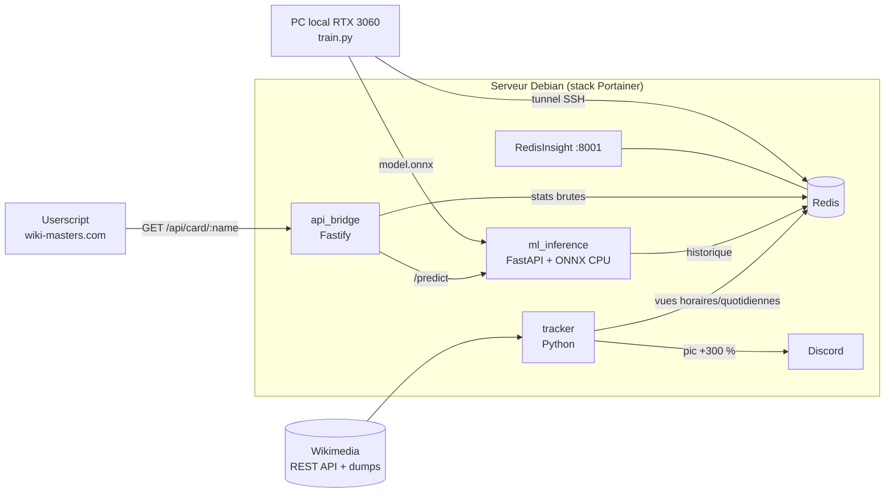

# WikiMasters

Suite d'outils open-source pour **analyser, prédire et exploiter l'économie du jeu
[WikiMasters](https://www.wiki-masters.com)**, où la valeur d'une carte dépend du trafic
de sa page Wikipédia.

- 🛰️ **Tracker** : collecte en continu le trafic Wikipédia des cartes et alerte sur Discord en cas de pic.
- 🧠 **Prédicteur ML** : LSTM PyTorch entraîné sur votre GPU, servi en ONNX sur le CPU d'un vieux serveur.
- 🔌 **API relais** : Fastify, unique point d'entrée, CORS limité à `https://www.wiki-masters.com`.
- 🖥️ **HUD** : userscript Tampermonkey qui affiche un *Trend Score* sous le prix de chaque carte.



## Sommaire

- [Structure du monorepo](#structure-du-monorepo)
- [Démarrage rapide (docker compose)](#démarrage-rapide-docker-compose)
- [Déploiement via Portainer](#déploiement-via-portainer)
- [Entraîner le modèle en local (GPU)](#entraîner-le-modèle-en-local-gpu)
- [Installer le userscript](#installer-le-userscript)
- [Référence de l'API](#référence-de-lapi)
- [Schéma Redis](#schéma-redis)
- [Développement et tests](#développement-et-tests)
- [Limites connues](#limites-connues)
- [Règles du jeu](#règles-du-jeu)

## Structure du monorepo

```
.
├── docker-compose.yml       # stack de production (Portainer)
├── .env.example             # toutes les variables, avec leurs défauts
├── Makefile                 # raccourcis : tests, tunnel, entraînement, déploiement du modèle
├── tracker/                 # Module 1 : bot Python, trafic Wikipédia + alertes Discord
│   ├── tracker.py           #   point d'entrée (boucle, --once, --add)
│   ├── wikimedia.py         #   API REST, API MediaWiki, dumps horaires
│   ├── storage.py           #   schéma Redis
│   ├── alerts.py            #   évolution 24 h, détection de pic, webhook Discord
│   └── articles.txt         #   articles suivis au démarrage
├── ml_predictor/            # Module 2 : pipeline de séries temporelles
│   ├── features.py          #   prétraitement partagé entraînement / inférence
│   ├── train.py             #   entraînement PyTorch (CUDA) + export ONNX
│   ├── inference_api.py     #   micro-service FastAPI, ONNX Runtime CPU
│   └── models/              #   model.onnx + model.json (non versionnés)
├── api_bridge/              # Module 3 : API relais Node.js / Fastify
│   └── src/app.js           #   GET /api/card/:name, CORS, cache, rate limit
└── userscript/              # Module 4 : HUD Tampermonkey
    └── wikimasters-hud.user.js
```

## Démarrage rapide (docker compose)

Prérequis : Docker Engine ≥ 24 avec le plugin Compose v2.

```bash
git clone https://github.com/MaKSiiMe/Wikimasters.git && cd Wikimasters
cp .env.example .env          # renseignez au moins DISCORD_WEBHOOK_URL
docker compose up -d --build
docker compose logs -f tracker
```

| Service | Accès | Rôle |
|---|---|---|
| `api_bridge` | `http://<serveur>:3000` | API consommée par le userscript |
| `redisinsight` | `http://<serveur>:8001` | exploration de la base |
| `redis` | `127.0.0.1:6379` (hôte uniquement) | stockage persistant (volume `redis_data`) |
| `tracker` | aucun port publié | collecte + alertes |
| `ml_inference` | aucun port, réseau interne uniquement | inférence ONNX |

Au premier démarrage, le tracker :
1. résout les 24 cartes de `tracker/articles.txt` (redirections comprises) ;
2. récupère **730 jours d'historique quotidien** par article (quelques secondes) ;
3. ingère les **48 dernières heures** de dumps horaires, 6 heures par cycle : la fenêtre
   horaire « 24 h glissantes » est donc disponible après environ 8 h. En attendant,
   l'évolution est calculée jour contre jour.

Sans modèle entraîné, `ml_inference` répond avec une heuristique de momentum
(`"model": "heuristic"`). Le HUD fonctionne donc dès le premier jour.

Pour ajouter une connexion dans RedisInsight manuellement : hôte `redis`, port `6379`.

## Déploiement via Portainer

La stack est pensée pour un petit serveur Debian : images slim/alpine, plafonds mémoire
par service (~1,9 Go cumulés au maximum), logs plafonnés à 30 Mo par service, et seul le
tracker sort sur Internet.

1. **Portainer → Stacks → Add stack**, nom : `wikimasters`.
2. Méthode de build **Repository** :
   - Repository URL : `https://github.com/MaKSiiMe/Wikimasters` (ou votre fork)
   - Reference : `refs/heads/main`
   - Compose path : `docker-compose.yml`
   - (optionnel) cochez **Automatic updates** pour redéployer à chaque push.
3. **Environment variables** : cliquez sur *Load variables from .env file* et chargez votre
   `.env`, ou saisissez au minimum :

   | Variable | Exemple | Pourquoi |
   |---|---|---|
   | `DISCORD_WEBHOOK_URL` | `https://discord.com/api/webhooks/…` | alertes de pic |
   | `MODEL_DIR_HOST` | `/opt/wikimasters/models` | **chemin absolu obligatoire** avec Portainer (le dépôt est cloné dans un dossier interne) |
   | `TRACKER_CONTACT` | `https://github.com/votre-compte/WikiMasters` | contact exigé dans le User-Agent Wikimedia |

4. Sur le serveur, créez le dossier des modèles (l'image tourne avec l'UID 10001, un accès
   en lecture suffit) :
   ```bash
   sudo mkdir -p /opt/wikimasters/models && sudo chmod 755 /opt/wikimasters/models
   ```
5. **Deploy the stack**. Vérifiez ensuite : `curl http://<serveur>:3000/health`
   → `{"status":"ok","redis":true,"ml":{…}}`.

> **Sécurité**
> - RedisInsight **n'a pas d'authentification**. Sur un serveur exposé à Internet,
>   mettez `REDISINSIGHT_BIND=127.0.0.1` et accédez-y par tunnel
>   (`ssh -L 8001:127.0.0.1:8001 serveur`).
> - Redis n'est publié que sur `127.0.0.1` de l'hôte, et `ml_inference` n'a aucun port
>   ni accès Internet (réseau `backend` en `internal: true`).
> - L'API refuse (403) toute requête de navigateur dont l'origine n'est pas
>   `https://www.wiki-masters.com`. Le CORS ne protège que des navigateurs : ne publiez pas
>   l'API sur Internet sans reverse proxy si vous voulez en limiter l'accès.

**Mettre à jour** : *Pull and redeploy* dans Portainer (ou automatique). Les volumes
`redis_data` et `redisinsight_data` sont conservés.

## Entraîner le modèle en local (GPU)

L'entraînement tourne sur votre machine (testé pour une **RTX 3060**) : PyTorch n'est
jamais installé sur le serveur, qui ne reçoit que le fichier ONNX (~130 Ko).

### 1. Environnement

```bash
cd ml_predictor
python3 -m venv .venv && source .venv/bin/activate
# PyTorch CUDA (pilote NVIDIA ≥ 560 pour cu126 ; cu130 existe aussi)
pip install torch==2.14.0 --index-url https://download.pytorch.org/whl/cu126
pip install -r requirements-train.txt
python -c "import torch; print(torch.cuda.is_available(), torch.cuda.get_device_name(0))"
```

Sous WSL2, le pilote NVIDIA Windows suffit : n'installez pas de pilote Linux.

### 2. Accéder au Redis du serveur

Redis n'écoute que sur `127.0.0.1` du serveur. Ouvrez un tunnel SSH dans un autre terminal :

```bash
ssh -N -L 6379:127.0.0.1:6379 user@mon-serveur     # ou : make tunnel SERVER=user@mon-serveur
```

### 3. Entraîner

```bash
python train.py --redis-url redis://localhost:6379/0
# test sans données : python train.py --synthetic 300 --epochs 5
```

Sortie réelle d'un entraînement sur 200 séries synthétiques (`--synthetic 200 --stride 2`, 6 époques) :

```
Generated 200 synthetic series of 540 days
Train windows: 39800 (7.61 % spikes, pos_weight=12.1) — val windows: 10000
TrendNet: 31826 parameters
epoch   6 | train 0.5952 | val 0.5565 | MAE 0.154 | dir 69.2 % | spike AUC 0.711 P 0.29 R 0.43 | 5.3s
Spike calibration (platt): a=1.055 b=-2.454 | Brier 0.1546 -> 0.0488 | P 0.88 R 0.26 at p>=0.5
Exported models/model.onnx (130 KB, ORT max diff 4.2e-07) — version lstm-20260928T022810Z
```

Sur GPU, une première ligne `Using GPU NVIDIA GeForce RTX 3060 (…)` confirme que CUDA est utilisé.

Ce que fait `train.py` :
- **Données** : l'historique quotidien de chaque article suivi (`wm:views:daily:*`).
- **Fenêtres** : 28 jours → 5 features invariantes au niveau de trafic (log normalisé,
  variation journalière, écart à la moyenne 7 j, jour de semaine).
- **Deux têtes** :
  - `trend` : log-ratio des 7 prochains jours sur les 7 derniers, qui donne le *Trend Score*
    `100·tanh(trend)` entre −100 et +100 ;
  - `spike_prob` : probabilité d'un jour à +300 % sous 7 jours, soit les « frémissements »
    avant l'explosion. Elle est calibrée (Platt) sur la validation.
- **Split temporel** par article, sans fuite de données ; early stopping ; TF32 sur Ampere.
- **Export ONNX** vérifié contre PyTorch avec ONNX Runtime, plus `model.json` (métadonnées,
  métriques) et `model.pt` (checkpoint).

Options utiles : `--epochs`, `--hidden`, `--layers`, `--batch-size`, `--lr`,
`--val-frac`, `--stride`, `--device cuda:0`, `--out`. Voir `python train.py --help`.

> La qualité dépend surtout du **nombre d'articles** suivis. Avec les 24 cartes par défaut,
> le modèle apprend peu : visez plusieurs centaines d'articles. Ajoutez-les à
> `articles.txt` ou `TRACKER_ARTICLES` (le HUD ajoute aussi automatiquement chaque carte
> vue sur la place de marché). Chaque nouvel article arrive avec 2 ans d'historique.

### 4. Déployer le modèle

```bash
scp models/model.onnx models/model.json user@mon-serveur:/opt/wikimasters/models/
# ou : make deploy-model SERVER=user@mon-serveur
```

Pas de redémarrage nécessaire : `ml_inference` recharge le modèle à chaud (vérification
toutes les 5 s). Contrôlez avec `curl http://<serveur>:3000/health`, où `ml.model` doit
afficher la nouvelle version. Un modèle construit pour une autre version des features est
refusé, et le service continue avec le précédent.

## Installer le userscript

1. Installez [Tampermonkey](https://www.tampermonkey.net/), puis ouvrez
   [`userscript/wikimasters-hud.user.js`](userscript/wikimasters-hud.user.js) en *raw*.
2. Sur wiki-masters.com : menu Tampermonkey → **⚙️ URL de l'API…**, puis **🩺 Tester la connexion**.

wiki-masters.com est servi en HTTPS : le navigateur bloque les appels vers une API en
`http://` (*mixed content*), sauf vers `http://localhost`. Trois options :

| Option | URL à configurer |
|---|---|
| Tunnel SSH : `ssh -N -L 3000:127.0.0.1:3000 user@serveur` | `http://localhost:3000` |
| Reverse proxy HTTPS (Caddy, Nginx Proxy Manager, Traefik…) avec `API_BIND=127.0.0.1` | `https://wikimasters-api.mondomaine.fr` |
| Stack lancée sur votre propre PC | `http://localhost:3000` |

Chrome peut demander d'autoriser l'accès au réseau local à wiki-masters.com : acceptez.
L'API répond aux pré-requêtes *Private Network Access*.

Légende des badges : voir [userscript/README.md](userscript/README.md).

## Référence de l'API

### `GET /api/card/:name`

`name` = nom de la carte tel qu'affiché (`Saturne (planète)`), encodé dans l'URL.

**200** : carte suivie

```json
{
  "status": "ok",
  "name": "Saturne (planète)",
  "article": "Saturne_(planète)",
  "wiki_url": "https://fr.wikipedia.org/wiki/Saturne_(plan%C3%A8te)",
  "evolution_pct": 39.24,
  "trend_score": 42,
  "spike_probability": 0.07,
  "direction": "up",
  "raw": {
    "window": "24h",
    "views_current": 1200,
    "views_previous": 862,
    "is_spike": false,
    "as_of": "2026092811",
    "updated_at": "2026-09-28T12:05:00+00:00"
  },
  "model": { "version": "lstm-20260928T022810Z", "as_of": "2026-09-27", "horizon_days": 7 }
}
```

- `evolution_pct` : évolution **brute** issue de Redis. Elle compare les 24 dernières heures
  aux 24 précédentes (`window: "24h"`, dumps horaires) ou, à défaut, le dernier jour au
  précédent (`"1d"`). Vaut `null` si l'article n'avait aucune vue sur la fenêtre précédente.
- `trend_score` : score **prédictif** du modèle (−100…+100), ou `null` si l'inférence est
  indisponible (champ `prediction_error`).

**202** `{"status":"pending"}` : carte inconnue, ajoutée à la file du tracker (données sous ~1 min).
**404** `{"status":"unknown"}` : aucun article Wikipédia ne correspond.
**403** : origine non autorisée. **429** : limite de débit. **503** : Redis indisponible.

### `POST /api/cards` (utilisé par le HUD)

Une seule requête pour toutes les cartes affichées (60 max). Chaque carte peut porter ce que
le HUD a lu dans le jeu, ce qui permet de calculer des signaux :

```json
{ "cards": [ { "title": "Saturne (planète)", "name": "Saturne (planète)", "rarity": "SR", "price": 800, "avg_price": 1000 } ] }
```

Réponse `{"results": [...]}` dans le même ordre ; chaque résultat reprend le format de
`GET /api/card/:name` (avec `http_status`), enrichi de :

- `rarity` : rareté estimée d'après le trafic (`estimated_30d` sur 30 jours glissants,
  `estimated_prev_month` sur le mois calendaire précédent), `views_30d`, prochain palier
  (`next`, `views_to_next`), date estimée de franchissement (`eta_days`) et risque de
  rétrogradation (`downgrade_eta_days`) ;
- `signals` : `verdict` (`buy` / `sell` / `watch` / `neutral`), `reasons` (code, texte, poids)
  et `price_delta_pct` (prix vs moyenne des ventes).

Règles des signaux ([api_bridge/src/signals.js](api_bridge/src/signals.js)) :

| Raison | Sens | Condition |
|---|---|---|
| ⭐ `rarity_upgrade` | achat | le trafic correspond à une rareté supérieure à celle affichée |
| ⚠ `rarity_downgrade` | vente | le trafic correspond à une rareté inférieure |
| 📈 `near_upgrade` | achat | palier suivant atteint en ≤ 7 jours au rythme actuel |
| 📉 `near_downgrade` | vente | rareté perdue en ≤ 7 jours (un pic sort de la fenêtre) |
| 🚀 `hype` | achat | ≥ +100 % sur 24 h et ≥ 200 vues |
| ⬇️ `cooling` | vente | ≤ −40 % sur 24 h |
| 💰 `cheap` / 💸 `expensive` | prix | enchère ≤ −15 % ou ≥ +25 % vs moyenne des ventes |

Le score ML est renvoyé à titre informatif (`trend_score`) : il n'entre pas dans le verdict
tant qu'il n'a pas battu ces règles sur un backtest.

### `POST /api/observations` (collecte du HUD)

Ce que le HUD a vu dans le jeu (rareté affichée, enchère, prix moyen des ventes, champs de la
carte comme les vues sur 30 jours ou le Q-Score), par lots de 100 max. Stocké dans
`wm:observations` et `wm:obs:latest:<titre>` pour retrouver la formule de rareté du jeu et
évaluer les signaux contre les vrais prix.

### `GET /health`

État de Redis et de l'inférence (version du modèle chargé).

### Inférence (réseau interne uniquement)

- `GET http://ml_inference:8000/predict?article=Chat`
- `POST /predict` avec `{"series": [120, 98, …], "end_date": "2026-09-27"}`
- `/docs` : OpenAPI, joignable depuis un conteneur du réseau `backend`.

## Schéma Redis

| Clé | Type | Contenu |
|---|---|---|
| `wm:articles` | SET | titres canoniques suivis |
| `wm:articles:pending` | SET | cartes demandées par l'API, à valider |
| `wm:articles:invalid` | SET | noms sans article Wikipédia |
| `wm:alias` | HASH | nom de carte normalisé → titre canonique |
| `wm:views:daily:<titre>` | HASH | `YYYYMMDD` → vues (API REST) |
| `wm:views:hourly:<titre>` | HASH | `YYYYMMDDHH` → vues (dumps, 14 j de rétention) |
| `wm:stats:<titre>` | HASH | dernière évolution brute + rareté estimée, palier suivant, ETA (lue par l'API) |
| `wm:meta:<titre>` | HASH | suivi interne (dernière collecte, début de couverture horaire) |
| `wm:dumps:done` | ZSET | heures de dumps traitées |
| `wm:alerts` | STREAM | historique des alertes |
| `wm:tracker:runs` | STREAM | journal des cycles du tracker |
| `wm:bridge:requests` | STREAM | journal des requêtes de l'API (~10 000 dernières) |
| `wm:observations` | STREAM | observations du HUD (~50 000 dernières) |
| `wm:obs:latest:<titre>` | HASH | dernière rareté / prix vus dans le jeu pour une carte |

Les titres utilisent la forme MediaWiki avec underscores (`Saturne_(planète)`). La règle de
normalisation est implémentée à l'identique en Python et en JavaScript.

## Développement et tests

```bash
# Python (tracker + ML) — un venv par module conseillé
pip install -r tracker/requirements-dev.txt
pip install -r ml_predictor/requirements-dev.txt   # + torch pour les tests d'entraînement
make test-tracker test-ml

# Node
cd api_bridge && npm ci && npm test

# Tout
make test
```

- `python tracker/tracker.py --once` exécute un cycle unique (avec `REDIS_URL`).
- `python tracker/tracker.py --add "Tour Eiffel"` suit un article supplémentaire.
- La CI GitHub Actions lance les tests des trois modules, vérifie le userscript et construit
  les images Docker.

## Limites connues

- **Horaire** : l'endpoint REST `per-article` n'accepte que `daily` et `monthly` (il répond
  400 pour `hourly`). Les volumes horaires viennent donc des
  [dumps Wikimedia](https://dumps.wikimedia.org/other/pageviews/), soit ~60 Mo téléchargés
  par heure (~1,4 Go/jour), traités en flux sans écriture disque. Ils sont publiés avec
  1 à 2 h de retard. Désactivable avec `ENABLE_HOURLY_DUMPS=false`.
- **Données du jeu** : le HUD lit les données internes des composants React du site
  (`wikipedia_title`, rareté, enchère). Si le jeu change sa structure, il retombe sur le
  texte affiché, et `CONFIG.selectors` centralise les sélecteurs.
- **Formule de rareté** : le jeu parle de « vues mensuelles » sans préciser la fenêtre, et ses
  chiffres semblent en retard sur Wikimedia (« Chat » : 22 227 vues affichées, 25 724 sur les
  30 derniers jours). Les deux hypothèses sont calculées ; les observations du HUD serviront à
  trancher.
- **Projet Wikipédia** : les cartes observées sont en français (`fr.wikipedia.org`).
  Changez `WIKI_PROJECT` si le jeu évolue.

## Règles du jeu

Les [règles de la communauté WikiMasters](https://www.wiki-masters.com/rules) (§3)
interdisent les bots et scripts qui jouent, ouvrent des paquets ou échangent à votre place,
ainsi que la modification ou l'interception du trafic du service. Ce projet est conçu pour
rester du côté de l'**analyse** :

- le tracker n'interroge que les API publiques de Wikimedia, jamais wiki-masters.com ;
- le userscript est en lecture seule : il ajoute un badge, ne clique sur rien, ne passe
  aucun ordre et n'intercepte aucune requête du jeu.

Vous restez seul responsable de l'usage de ces outils sur votre compte.

## Licence

[MIT](LICENSE). Données de trafic : [Wikimedia Foundation](https://wikimediafoundation.org/)
(CC0). Projet indépendant, sans lien avec WikiMasters ni la Wikimedia Foundation.
